# Convo Desk 🤖📞📅
### Conversational AI Customer Intake, Inbound Voice Call Center & Google Calendar Scheduling

**Convo Desk** is an enterprise-grade conversational AI platform designed for automated customer intake, contextual qualification, inbound call center voice interactions, and direct calendar appointment scheduling with Google Meet integration.

---

## 🛠️ Tech Stack & Tools Overview

### 1. Frontend
| Tool / Library | Version | Purpose |
| :--- | :--- | :--- |
| **Next.js** | 16 (App Router) | High-performance React framework with server/client component architecture. |
| **React** | 19 | UI component model, hooks, and reactive state management. |
| **TypeScript** | 5 | Compile-time type safety across all messages, modals, and appointments. |
| **Tailwind CSS** | 4 | Modern responsive UI styling with lavender/purple aesthetic and glassmorphism. |
| **Lucide React** | Latest | Crisp iconography for phone calls, calendar, equalizer, and intake status. |
| **Web Speech API** | Native Browser | Powers both voice dictation and the hands-free **Inbound Call Center** speech-to-speech mode (`SpeechRecognition` & `SpeechSynthesis`). |
| **Server-Sent Events (SSE)** | Native `EventSource` | Real-time word-by-word streaming generation from LLM backends. |

### 2. Backend
| Tool / Library | Version | Purpose |
| :--- | :--- | :--- |
| **FastAPI** | 0.162+ | Asynchronous high-throughput web framework with OpenAPI / Swagger documentation. |
| **Python** | 3.14 | Modern async Python runtime. |
| **Uvicorn** | 0.54+ | Lightning-fast ASGI web server with auto-reloading. |
| **Pydantic** | 2.14+ | Request validation, data serialization, and environment configuration (`pydantic-settings`). |
| **SQLite3** | 3.50+ | Persistent local database storing appointments, sent invitations, and OAuth tokens. |
| **HTTPX** | 0.28+ | Asynchronous HTTP client for Google OAuth2 token exchanges and Google Calendar API v3 calls. |
| **smtplib & email.mime** | Python Standard Lib | Gmail SMTP email dispatch with RFC 5545 `.ics` attachments and responsive HTML templates. |

### 3. AI & LLM Engines
| Provider | Supported Models | Role |
| :--- | :--- | :--- |
| **Mistral AI** *(Active)* | `ministral-8b-latest`, `ministral-3b-latest`, `codestral-latest` | Powers the 6-step customer intake, contextual follow-up questions, and date parsing. |
| **Google Gemini** | `gemini-2.5-flash`, `gemini-2.5-pro` | Multi-modal conversational reasoning. |
| **OpenAI** | `gpt-4o-mini`, `gpt-4o` | High-accuracy structured conversation. |
| **Deterministic Mock Mode** | Built-in State Machine | Zero-key simulation engine allowing 100% offline development and testing. |

### 4. Calendar & Email Integrations
| Service | Mechanism | Description |
| :--- | :--- | :--- |
| **Google Calendar API v3** | REST API & OAuth 2.0 | Directly creates events on the host's Google Calendar grid and creates **Google Meet** video conference rooms. |
| **Google OAuth 2.0** | Authorization Code Grant | Secure token persistence in SQLite with auto-refresh using `refresh_token`. |
| **Google Native Invites** | `sendUpdates=all` | Automatically sends official Google Calendar invitations to the customer's email. |
| **Gmail SMTP Delivery** | STARTTLS Port 587 | Dispatches branded HTML confirmation receipts with embedded RFC 5545 `invite.ics` files for 1-click RSVP. |
| **1-Click Web Sync** | URL Generation | Instant pre-filled `calendar.google.com/calendar/render` links. |
| **RFC 5545 .ics Export** | iCalendar Standard | Downloadable calendar files for Outlook, Apple Calendar, and mobile devices. |

---

## 🌟 Core Business Requirements & Features

### 1. 6-Step Strict Customer Intake Workflow
1. **Official Greeting**: Warm welcome explaining Convo Desk capabilities and requesting the customer's full name.
2. **Contact Capture**: Collects 10-digit phone number (worldwide support including India and US) and validated email address.
3. **Purpose of Enquiry**: Collects consultation topic (e.g. cloud migration, software demo, pricing).
4. **Mandatory Contextual Follow-Up Question**: Generates a smart, insightful follow-up question tailored to the customer's specific enquiry *before* asking for scheduling.
5. **Customer-Led Scheduling**: Directly asks for preferred date/time first; only suggests available time slots if the customer asks or does not specify.
6. **Confirmation & Receipt**: Outputs structured confirmation receipt table with reference ID (`CNV-XXXX`) and auto-dispatches calendar invitations.

### 2. Inbound Call Center Voice Mode
- Hands-free full-duplex call center simulation.
- Real-time animated audio equalizer bars reflecting speech activity.
- Live caller transcript and agent utterance history.
- Controls: Call duration timer, mute microphone, mute speaker, end call.
- Post-call review drawer with auto-extracted customer profile.

### 3. Direct Google Calendar Hub
- Top navbar connection badge (`🟢 Connected` / `🟡 Action Required`).
- Dedicated integration modal displaying scheduled appointments, sent customer invitations, and OAuth credentials.
- 1-click "Connect Google Calendar" authorization button.

---

## 📸 Live System Process & Workflow Walkthrough

Below is the verified end-to-end customer journey demonstrating name capture, multi-stage input validation, contextual follow-ups, and automated scheduling:

### 1. Welcome Greeting & Name Intake
When a customer sends an initial message, Convo Desk introduces itself and asks for their full name to personalize the intake session.

<p align="center">
  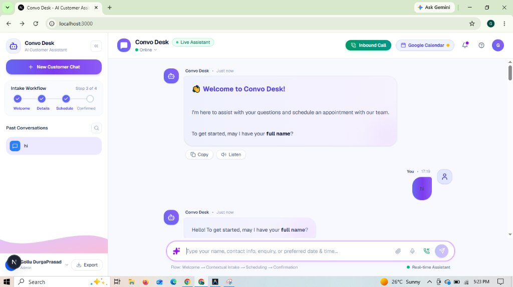
</p>

### 2. Personalized Contact Phone Request
Upon receiving the customer's name (*Prasad*), Convo Desk acknowledges them by name and asks for their 10-digit contact number.

<p align="center">
  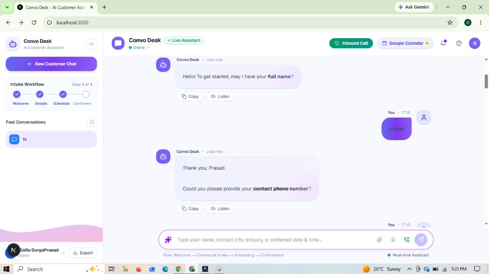
</p>

### 3. Strict Phone Number Validation
If the customer provides an invalid number (e.g., `678` with fewer than 10 digits), Convo Desk intercepts it, explains that 10 digits are required, and prompts again. Entering a valid 10-digit number (`7330640851`) is accepted without friction.

<p align="center">
  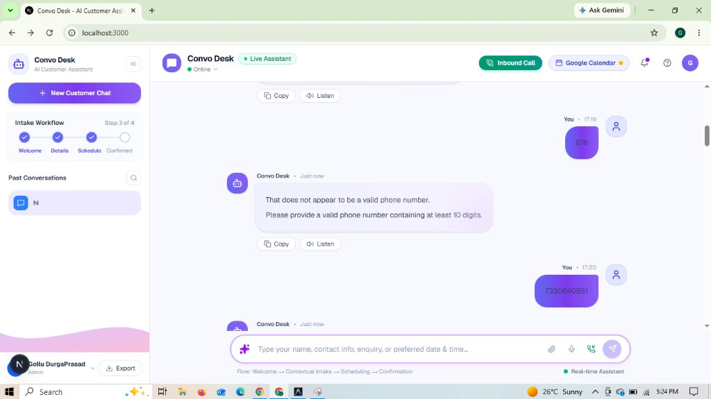
</p>

### 4. Phone Confirmation & Email Address Request
Once the phone number is verified, the assistant moves to the next requirement: collecting a valid email address.

<p align="center">
  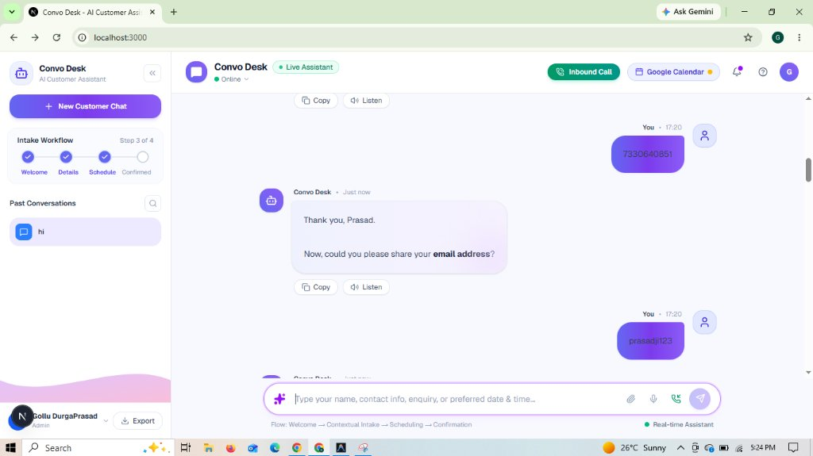
</p>

### 5. Strict Email Format Validation & Purpose Prompt
When an invalid email format without `@` or domain is entered (e.g., `prasadji123`), the validator rejects it and prompts for a valid email. Upon receiving a valid email (`n180972@rguktn.ac.in`), it moves to asking for the purpose of the enquiry.

<p align="center">
  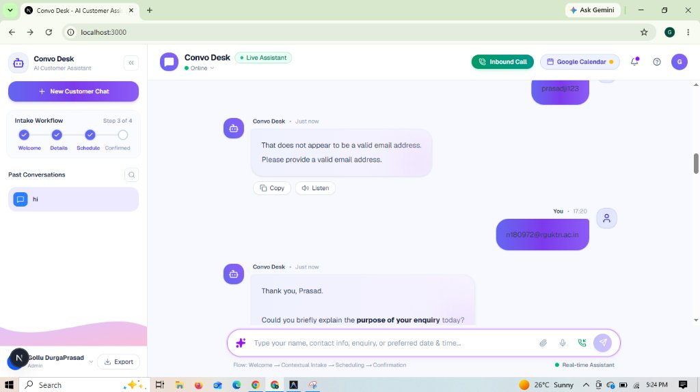
</p>

### 6. Purpose of Enquiry & Contextual Follow-Up Question
When the customer states their project (*"I want to develop an AI chatbot for my business."*), Convo Desk asks **exactly one** intelligent, tailored follow-up question (*"Got it, Prasad. To better assist you, which industry or business type are you developing the chatbot for?"*) to clarify their requirements before scheduling.

<p align="center">
  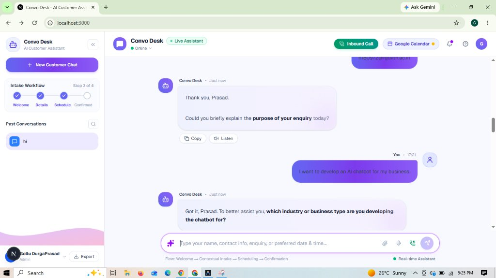
</p>

### 7. Follow-Up Answered & Customer-Led Scheduling Prompt
Upon the customer answering (*"An e-commerce business."*), the assistant immediately transitions to scheduling, asking the customer for their preferred date and time first rather than bombarding them with rigid slot options.

<p align="center">
  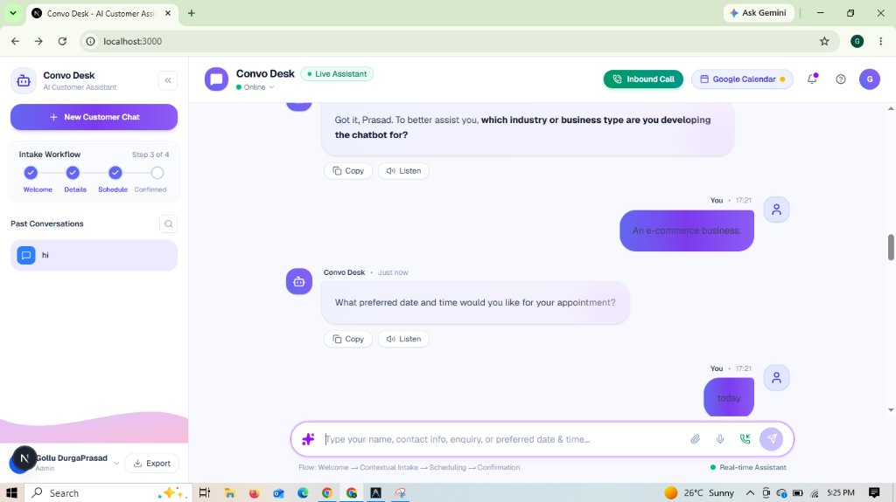
</p>

### 8. Real Calendar Date Negotiation & Availability Check
If the customer requests a same-day slot that is unavailable, Convo Desk politely suggests alternative real dates based on current calendar context (*tomorrow, November 11, 2026*) and asks for their preferred time window.

<p align="center">
  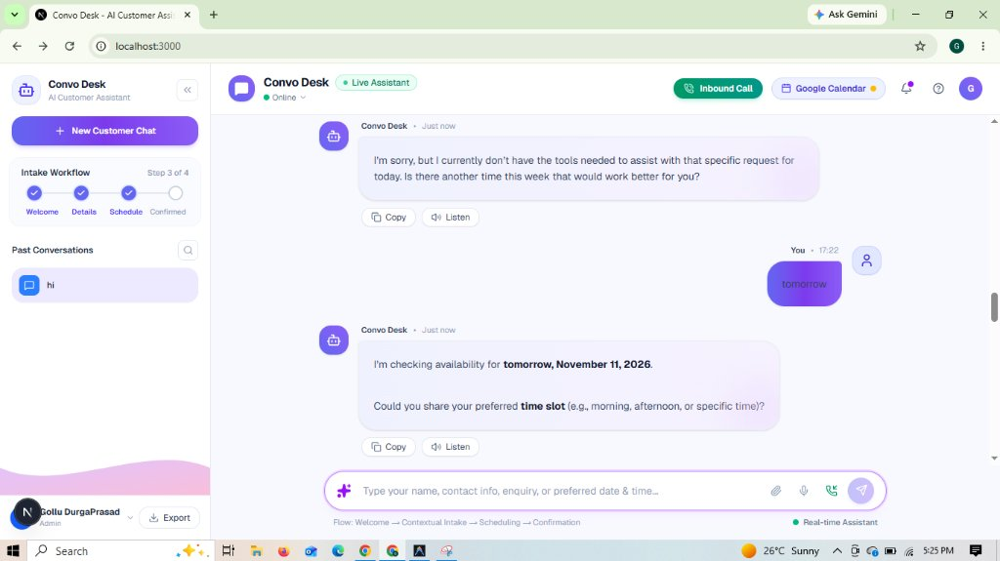
</p>

### 9. Preferred Time Slot Selection & Confirmation
When the customer picks their exact time slot (*"11:00Am"*), Convo Desk confirms availability for that specific date & time and asks to proceed.

<p align="center">
  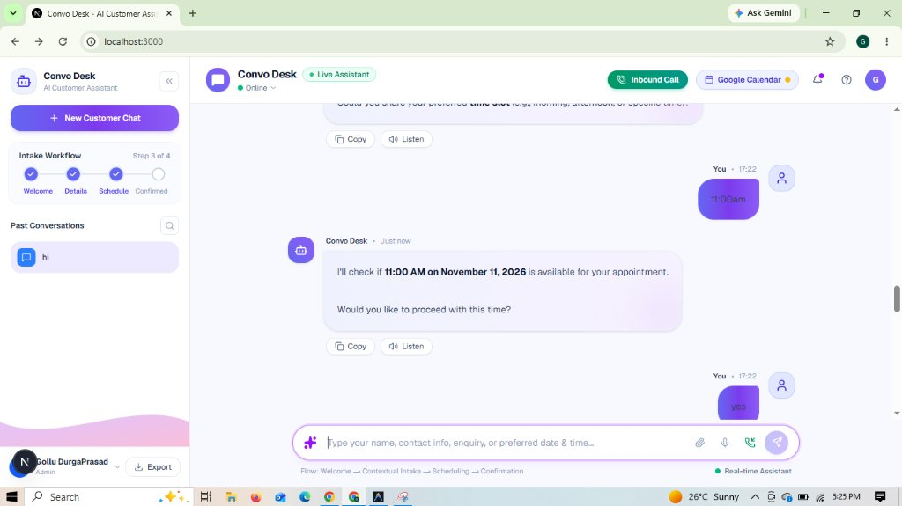
</p>

### 10. Pre-Booking Details Verification
Before finalizing the reservation, Convo Desk summarizes the full intake dossier (Full Name, Phone Number, Email Address, and Purpose) to ensure 100% accuracy.

<p align="center">
  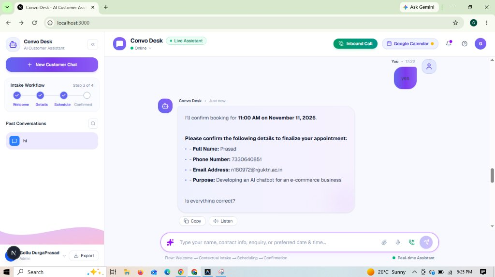
</p>

### 11. Official Appointment Confirmed Receipt Card
Once the booking is finalized, Convo Desk emits the rich interactive green confirmation receipt card displaying all **6 verified fields**: Reference ID (`ECOM-AI-2026-110111-001`), Customer Name (*Prasad*), Contact Number (`7330640851`), Email Address (`n180972@rguktn.ac.in`), Purpose of Enquiry (*Developing an AI chatbot for an e-commerce business*), and Scheduled Date & Time (*November 11, 2026, at 11:00 AM*).

<p align="center">
  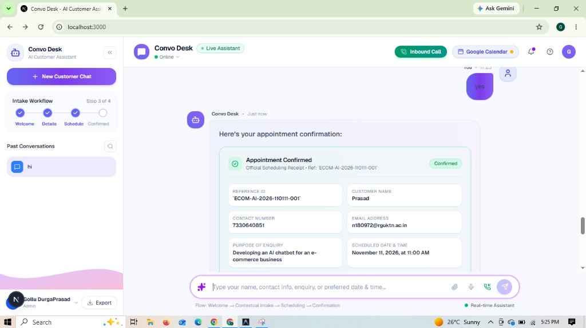
</p>

### 12. Direct Google Calendar & Google Meet Integration
Below the receipt, the Google Calendar box provides 1-click actions: direct pre-filled synchronization to Google Calendar with a **Google Meet video call** link, instant `.ics` file download, and full consultation receipt export.

<p align="center">
  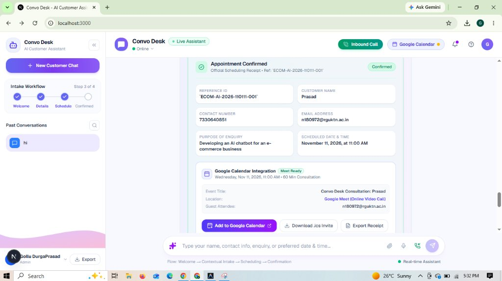
</p>

### 13. Customer Calendar Event Auto-Delivery
Convo Desk automatically dispatches the calendar invitation directly to the customer's email address (`n180972@rguktn.ac.in`) with options to re-dispatch or view the live email template.

<p align="center">
  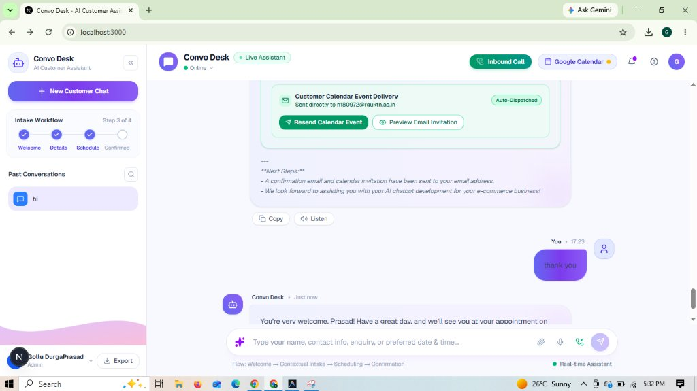
</p>

### 14. Interactive Customer Calendar Email Preview
Clicking **Preview Email Invitation** opens a modal showcasing the exact responsive HTML calendar invite received by the customer, including embedded RFC 5545 `.ics` attachments and Google Meet access details.

<p align="center">
  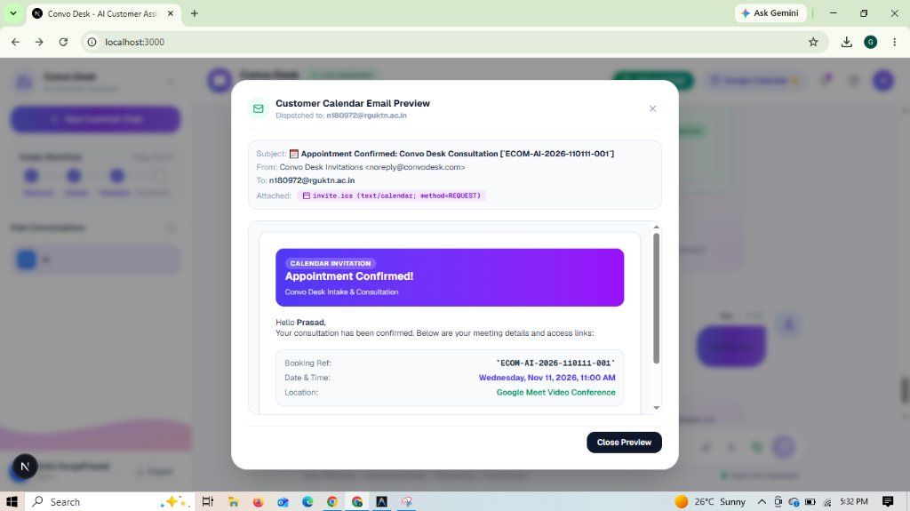
</p>

### 15. Courteous Completion & Friendly Sign-Off
When the customer responds with gratitude (*"thank you"*), Convo Desk closes the conversation warmly, wishing them a great day and reminding them of their appointment time (*November 11 at 11:00 AM*).

<p align="center">
  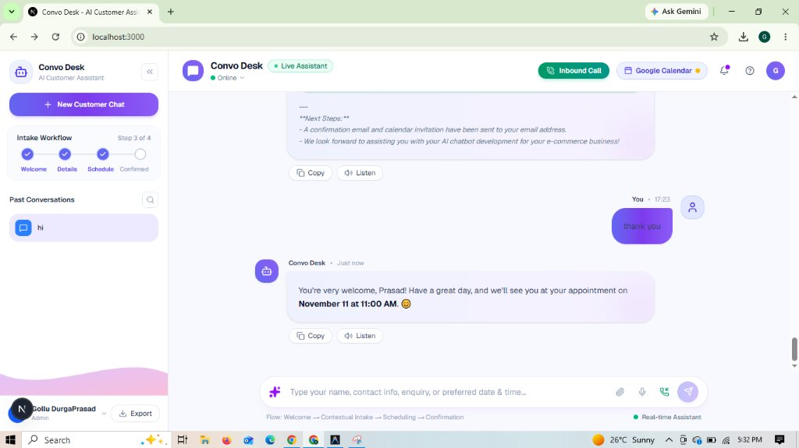
</p>

---

## 🚀 Getting Started

### 1. One-Click Launch (Windows)
Double-click `start.bat` or run:
```powershell
.\start.bat
```
This automatically launches both the FastAPI backend and Next.js frontend in separate terminal windows.

---

### 2. Manual Startup

#### Backend Setup:
```powershell
cd backend
.\venv\Scripts\activate
python -m uvicorn app.main:app --host 127.0.0.1 --port 8000 --reload
```
- API Documentation (Swagger): [http://127.0.0.1:8000/docs](http://127.0.0.1:8000/docs)
- Alternative Redoc: [http://127.0.0.1:8000/redoc](http://127.0.0.1:8000/redoc)

#### Frontend Setup:
```powershell
cd frontend
npm run dev
```
- Open application at: [http://localhost:3000](http://localhost:3000)

---

## 🔑 Environment Configuration (`backend/.env`)

```env
# Server
HOST=0.0.0.0
PORT=8000
DEBUG=True

# LLM Providers
ACTIVE_PROVIDER=mistral
MISTRAL_API_KEY=your_mistral_api_key_here
DEFAULT_MISTRAL_MODEL=ministral-8b-latest

# Gmail SMTP Email Dispatch (For sending calendar invitations)
SMTP_HOST="smtp.gmail.com"
SMTP_PORT="587"
SMTP_USER="your_email@gmail.com"
SMTP_PASSWORD="your_16_char_app_password"
SMTP_FROM_EMAIL="your_email@gmail.com"
SMTP_FROM_NAME="Convo Desk Invitations"

# Google Calendar OAuth 2.0 Integration
GOOGLE_CLIENT_ID="your_client_id.apps.googleusercontent.com"
GOOGLE_CLIENT_SECRET="your_client_secret"
GOOGLE_CALENDAR_ID="primary"
```

---

## 📡 API Endpoints Reference

| Method | Endpoint | Description |
| :--- | :--- | :--- |
| `POST` | `/api/chat/stream` | Server-Sent Events (SSE) streaming conversational intake endpoint. |
| `POST` | `/api/chat` | Non-streaming completion endpoint. |
| `GET` | `/api/welcome` | Initial official customer intake greeting. |
| `GET` | `/api/appointments` | Lists all booked appointments from SQLite database. |
| `PATCH` | `/api/appointments/{id}/status` | Updates appointment status (`confirmed`, `completed`, `cancelled`). |
| `DELETE`| `/api/appointments/{id}` | Deletes appointment by reference ID. |
| `GET` | `/api/calendar/status` | Returns integration status, OAuth link state, and SMTP health. |
| `GET` | `/api/calendar/auth/login` | Initiates Google OAuth consent flow. |
| `GET` | `/api/calendar/auth/callback`| OAuth redirect callback; stores access/refresh tokens in SQLite. |
| `GET` | `/api/calendar/auth/status` | Returns current Google OAuth connection status. |
| `POST` | `/api/calendar/auth/disconnect` | Revokes and clears stored OAuth tokens. |
| `POST` | `/api/calendar/events` | Persists appointment and generates calendar sync payload. |
| `POST` | `/api/calendar/send-invite` | Directly injects event to Google Calendar API and dispatches email. |
| `GET` | `/api/calendar/invitations` | Returns history of dispatched customer invitations. |
| `GET` | `/api/calendar/ics/{id}` | Generates and downloads RFC 5545 `.ics` file. |

---

## 🧪 Automated Test Suite

Run the full end-to-end backend verification test:
```powershell
$env:PYTHONPATH="backend"
.\backend\venv\Scripts\python.exe backend/test_backend.py
```
This script validates:
- Requirement 1: Official Welcome Greeting
- Requirement 2 & 3: Customer Details & Contextual Follow-up Question
- Requirement 4 & 5: Date/Time Scheduling & Receipt Generation
- Requirement 6: Error Handling for Incomplete or Invalid Inputs

---

## 📁 Repository Structure

```
convo_ai/
├── backend/
│   ├── app/
│   │   ├── config.py                 # Pydantic environment settings
│   │   ├── db.py                     # SQLite schema (appointments, invites, oauth tokens)
│   │   ├── main.py                   # FastAPI REST API & SSE router
│   │   ├── schemas.py                # Pydantic models for chat & models
│   │   └── services/
│   │       ├── google_calendar.py    # Google Calendar API, Meet & SMTP dispatch
│   │       ├── intake_manager.py     # 6-step prompt engineering & state tracker
│   │       └── llm.py                # Streaming adapters for Mistral, Gemini & OpenAI
│   ├── appointments.db               # SQLite database
│   ├── requirements.txt              # Backend dependencies
│   ├── test_backend.py               # Automated test suite
│   ├── .env                          # Local environment variables
│   └── .env.example                  # Template environment file
├── frontend/
│   ├── src/app/
│   │   ├── globals.css               # Tailwind CSS theme
│   │   ├── layout.tsx                # App root layout
│   │   └── page.tsx                  # Main interactive UI & Inbound Call Center
│   ├── package.json                  # Next.js dependencies
│   └── tsconfig.json                 # TypeScript configuration
├── start.bat                         # Windows one-click launcher
└── README.md                         # Project documentation
```
